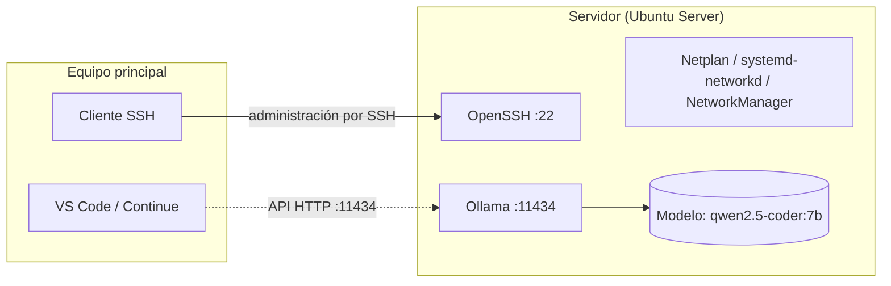

# Montar el servidor de IA local con Ubuntu Server y Ollama

> **Estado:** Runbook preparado. Los comandos no se han ejecutado de principio a fin en este repositorio. No incluye firewall, TLS ni endurecimiento de SSH: ver la sección 6.

Esta guía instala un servidor sin pantalla, con Ubuntu Server, que ejecuta modelos de lenguaje con Ollama. Tú lo administras por SSH desde otro equipo.

## 1. Por qué Ubuntu Server sin escritorio

- **Toda la memoria para el modelo.** Sin entorno gráfico, la RAM y la memoria de la tarjeta gráfica se dedican a cargar el modelo.
- **Menos superficie de ataque.** Menos programas corriendo significa menos cosas que pueden fallar o ser atacadas.
- **Se gestiona por línea de comandos.** Todo se hace por SSH, desde el equipo principal.

La topología es esta:

- **Servidor:** Ubuntu Server con el servicio `ollama` escuchando en el puerto 11434.
- **Equipo principal:** se conecta al servidor por SSH y usa el modelo desde su editor o su terminal.



## 2. Red

Una instalación mínima de Ubuntu Server no trae herramientas de Wi-Fi como `nmtui` ni `NetworkManager`. El arranque de la red se hace en dos fases.

### Fase 1: cable y Netplan

Conecta el servidor por cable. Define la red con Netplan en `/etc/netplan/01-netcfg.yaml` (el nombre puede cambiar según el instalador):

```yaml
network:
  version: 2
  renderer: networkd
  ethernets:
    enp3s0:
      dhcp4: true
```

Aplica el cambio:

```bash
sudo netplan apply
```

Sustituye `enp3s0` por el nombre real de tu interfaz (`ip a` lo muestra).

### Fase 2: Wi-Fi, si lo necesitas

Cuando el servidor ya tiene salida a internet por cable, instala la herramienta de Wi-Fi y configura la red inalámbrica:

```bash
sudo apt update && sudo apt install network-manager -y
sudo nmtui
```

Con `nmtui` conectas la red inalámbrica y se guarda el perfil.

## 3. Acceso por SSH

1. Comprueba que SSH está activo:

   ```bash
   sudo systemctl status ssh
   ```

2. Mira la IP del servidor en tu red local:

   ```bash
   ip a
   ```

3. Conéctate desde tu equipo principal:

   ```bash
   ssh usuario@IP_DEL_SERVIDOR
   ```

Sustituye `IP_DEL_SERVIDOR` por la IP de tu red. En la documentación del repositorio usa siempre marcadores como `usuario` o `ollama.lab.local`, nunca una IP real.

## 4. Instalar Ollama

```bash
curl -fsSL https://ollama.com/install.sh | sh
```

Comprueba que el servicio está en marcha:

```bash
sudo systemctl status ollama
```

Por defecto, Ollama queda registrado como servicio de sistema y escucha en el puerto 11434.

## 5. Descargar un modelo y probarlo

```bash
ollama run qwen2.5-coder:7b
```

La primera vez descarga el modelo. Después puedes escribir una pregunta y ver la respuesta. Para comprobar el consumo mientras responde:

- **Velocidad:** cuántos tokens por segundo produce. Un token es un trozo de palabra.
- **Memoria:** `top` o `htop` muestran la RAM y la CPU. Si tienes tarjeta NVIDIA, `nvidia-smi` muestra su memoria.

El modelo operativo del laboratorio es `qwen2.5-coder:7b`. Se probaron también Llama 3 y Mistral al inicio, sin dejar registro en el repositorio.

## 6. Seguridad antes de usarlo desde otro equipo

Ollama no tiene autenticación propia. Por eso:

- No publiques el puerto 11434 en Internet.
- Limita el acceso a la red de laboratorio con un firewall.
- Si necesitas acceso desde fuera de tu red, usa un proxy con TLS y autenticación. No abras el puerto directamente.
- Verifica dónde escucha el servicio con `ss -lntp | grep 11434`.

El repositorio no verifica estos controles. Si los montas, regístralos en la bitácora con la fecha.
