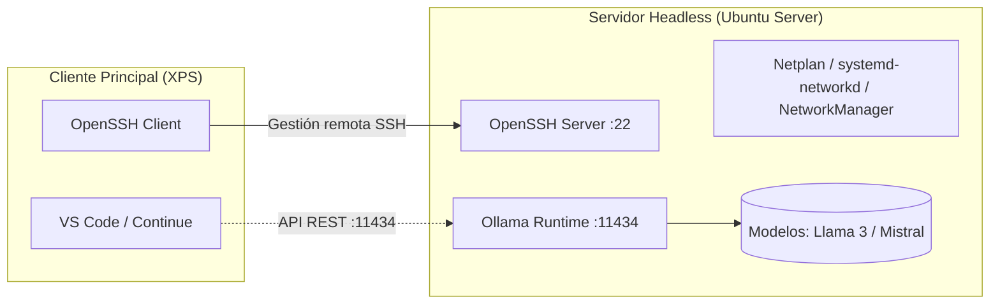

# Despliegue de Servidor de IA Local con Ubuntu Server y Ollama

Guía técnica de arquitectura, instalación y resolución de conectividad para el despliegue de un servidor bare-metal dedicado (Ubuntu Server) orientado a la inferencia de Modelos de Lenguaje de Gran Tamaño (LLMs) con Ollama, administrado remotamente vía SSH desde un equipo cliente de trabajo (XPS).

---

## 1. Descripción del Escenario y Justificación Técnica

### Selección de Ubuntu Server (Headless)
- **Optimización de Recursos (VRAM / RAM):** Se implementó una instalación pura por línea de comandos (CLI sin entorno de escritorio ni gestor de ventanas tipo GNOME o Wayland) con el objetivo de maximizar la memoria RAM y VRAM dedicada íntegramente al cómputo y carga de tensores de los modelos de lenguaje (LLMs).
- **Estabilidad y Reducción de Superficie de Ataque:** Infraestructura minimalista gobernada por `systemd`, eliminando procesos innecesarios en segundo plano y reduciendo la exposición de servicios auxiliares.
- **Topología de Trabajo:**
  - **Servidor Bare-Metal:** Ubuntu Server ejecutando el daemon de `ollama` en el puerto 11434.
  - **Cliente de Administración:** Equipo principal (XPS) conectado mediante SSH seguro (OpenSSH) y clientes de inferencia local.



---

## 2. Diagnóstico y Resolución de Conectividad en Servidor Mínimo

En instalaciones limpias de Ubuntu Server (versión headless mínima), no vienen preinstaladas utilidades interactivas de gestión Wi-Fi de usuario como `nmtui`, `NetworkManager` ni `dhclient`. Para resolver el bootstrap inicial de red se aplicó una estrategia de conectividad en dos fases:

### Fase 1: Conectividad Declarativa Ethernet con Netplan
Se conectó el servidor por cable de red y se definió la configuración declarativa mediante Netplan y `systemd-networkd` para obtener salida a repositorios:

1. Edición de `/etc/netplan/01-netcfg.yaml` (o archivo correspondiente según el instalador):
   ```yaml
   network:
     version: 2
     renderer: networkd
     ethernets:
       enp3s0:
         dhcp4: true
   ```
2. Aplicación de la configuración de red:
   ```bash
   sudo netplan apply
   ```

### Fase 2: Aprovisionamiento de Gestión Inalámbrica
Una vez garantizado el acceso a internet a través del enlace Ethernet, se instalaron las herramientas necesarias para dotar al servidor de flexibilidad física sin perder la administración remota:

```bash
sudo apt update && sudo apt install network-manager -y
sudo nmtui
```
Con `nmtui` se conectó la interfaz inalámbrica a la red local y se persistió el perfil de red.

---

## 3. Acceso Remoto Seguro (OpenSSH)

1. **Verificación del servicio SSH:**
   ```bash
   sudo systemctl status ssh
   ```
2. **Obtención de la IP asignada en la red local:**
   ```bash
   ip a
   ```
3. **Conexión remota desde el equipo cliente (XPS):**
   ```bash
   ssh usuario@IP_DEL_SERVIDOR
   ```

---

## 4. Instalación y Despliegue del Motor Ollama

1. **Instalación del Runtime oficial:**
   ```bash
   curl -fsSL https://ollama.com/install.sh | sh
   ```
2. **Verificación del estado del daemon:**
   ```bash
   sudo systemctl status ollama
   ```
   *El servicio queda registrado como servicio de sistema en systemd, escuchando por defecto en el puerto local 11434.*

---

## 5. Descarga e Inferencia de Modelos de IA

1. **Descarga de pesos e inicio de sesión interactiva:**
   ```bash
   ollama run qwen2.5-coder:7b
   ```
2. **Validación de inferencia y consumo de recursos:**
   - Comprobación de tiempos de respuesta por token (tokens/segundo).
   - Verificación de uso de memoria y procesador mediante herramientas de monitorización (`top`, `htop`, o `nvidia-smi` si dispone de GPU dedicada).
   - Evaluación adicional con modelos complementarios (por ejemplo, `llama3` o `mistral`), conservando `qwen2.5-coder:7b` como modelo operativo del laboratorio.

---

## 6. Stack Tecnológico

| Capa | Componente / Tecnología | Propósito |
|---|---|---|
| **Sistema Operativo** | Ubuntu Server (Headless / CLI) | Base mínima optimizada para cómputo |
| **Pila de Red** | Netplan / systemd-networkd / NetworkManager | Bootstrap por cable y enlace Wi-Fi |
| **Administración** | OpenSSH | Gestión remota segura sin interfaz gráfica |
| **Motor de Inferencia** | Ollama | Servidor y runtime de modelos locales |
| **Modelos Evaluados** | Llama 3 / Mistral | Inferencia offline privada |
